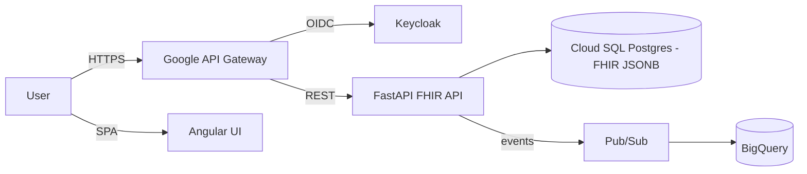

# FHIR Healthcare Analytics Platform

A HIPAA-aware **FHIR (HL7 R4)** REST API and Angular UI for healthcare analytics, deployed on
**GCP (GKE + BigQuery + Pub/Sub)**. This is a **demonstration project** — not production software —
that exercises healthcare interoperability, privacy/compliance, and cloud-native patterns in the
stack used by CVS Health's digital teams (Python, Angular, GCP).

> **Purpose:** close the CVS Health Principal SDE (Java/Angular) gaps — GCP/GKE/Google DBs,
> Python backend, healthcare/FHIR/HIPAA, and API-first lifecycle — with verifiable, running code.

## Tech stack

| Layer | Technology |
|---|---|
| API | Python 3.12, FastAPI, Pydantic, uvicorn, pytest |
| Standard | HL7 FHIR R4 (Patient, Claim, Observation) |
| Frontend | Angular 22 (standalone), TypeScript, RxJS, signals |
| Auth | Keycloak (OIDC/OAuth2), RBAC |
| Cloud | GCP — GKE (Autopilot), BigQuery, Pub/Sub, Cloud SQL (Postgres), Artifact Registry, Cloud Build, Google API Gateway, Secret Manager |
| IaC | Terraform (VPC/firewall/GKE) + Helm |

## Architecture



Full structure, data model, and decisions:
**[docs/ARCHITECTURE.md](docs/ARCHITECTURE.md)** · decisions: **[docs/adr/](docs/adr/)**

## Project structure

```
fhir-healthcare-platform/
├── api/            # Python FastAPI FHIR service (Patient/Claim/Observation)
├── ui/             # Angular 22 SPA
├── terraform/      # GCP IaC: VPC, firewall, GKE Autopilot, BigQuery, Pub/Sub
├── helm/           # GKE deployment chart
├── infra/          # Keycloak realm + API gateway (OpenAPI) config
├── docs/           # architecture, ADRs, roadmap, phases
└── docker-compose.yml
```

## Run locally

```bash
docker compose up --build
# API → http://localhost:8000/fhir/Patient
# UI  → http://localhost:4200
```

## Deploy to GCP

```bash
cd terraform && terraform apply        # VPC + GKE Autopilot + BigQuery + Pub/Sub
helm upgrade --install fhir ./helm     # deploy API + UI to GKE
```

## FHIR API

- `GET /fhir/Patient/{id}` — retrieve a patient.
- `POST /fhir/Patient` — create a patient (synthetic data).
- `GET /fhir/Claim?patient={id}` — search claims.
- `GET /fhir/Observation?patient={id}` — search observations.
- `GET /fhir/metadata` — CapabilityStatement.

All data is **synthetic** — no real PHI.

## Demo walkthrough (5 min)

1. `GET /fhir/Patient/{id}` → FHIR JSON.
2. Toggle **de-identification** → PHI fields redacted.
3. Show the **audit log** — every access recorded.
4. Log in as **clinician vs admin** → different scopes (RBAC/OIDC).
5. "Runs on GCP GKE; analytics in BigQuery."

## Docs

| Doc | Purpose |
|---|---|
| [docs/ARCHITECTURE.md](docs/ARCHITECTURE.md) | System shape, components, data model |
| [docs/adr/](docs/adr/) | Decision log |
| [docs/ROADMAP.md](docs/ROADMAP.md) | Now / Next / Later |
| [docs/PHASES.md](docs/PHASES.md) | Work breakdown + status |
| [docs/DEMO_SCRIPT.md](docs/DEMO_SCRIPT.md) | Recording / walkthrough scripts (browser + terminal) |
| [AGENTS.md](AGENTS.md) | AI coding-agent instructions |
