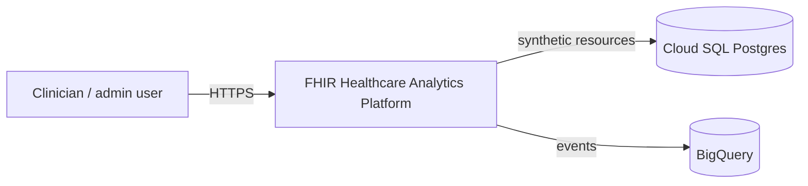
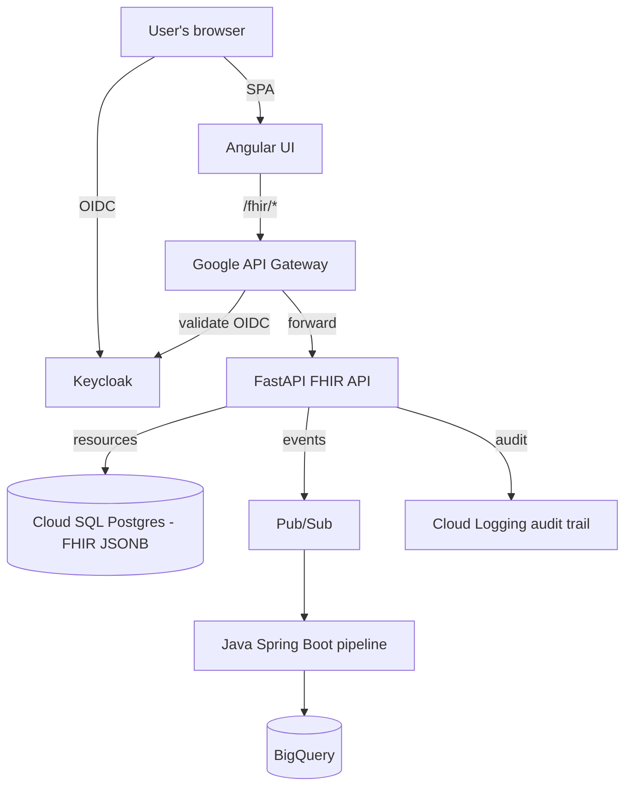
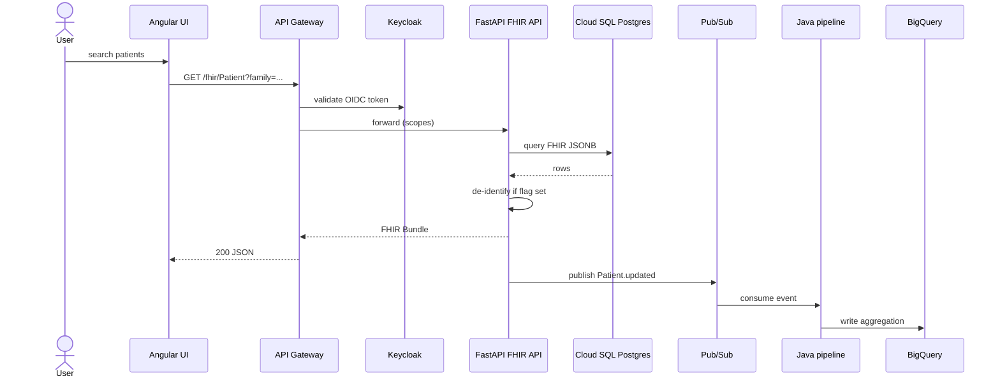
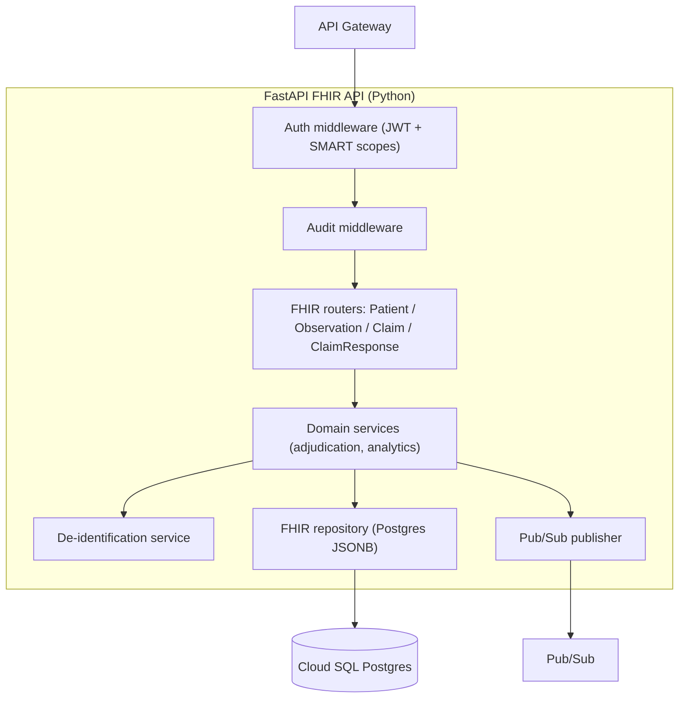
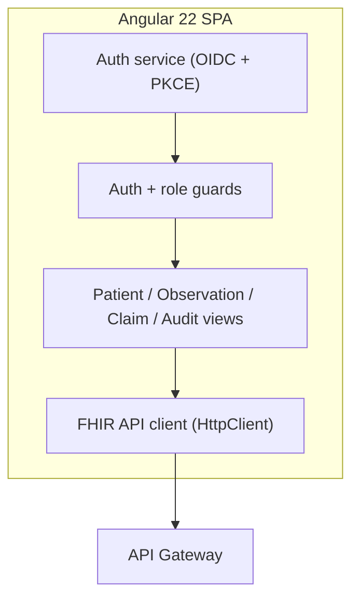

# Architecture — FHIR Healthcare Analytics Platform

> C4-lite view of the FHIR Healthcare Analytics Platform demo. Decisions ("why") live in
> [`docs/adr/`](adr/).

## 1. System Context (C4 Level 1)

A single self-contained system: a FHIR API + Angular UI that ingest synthetic patient/claim/
observation data, apply PHI de-identification, log audit events, and aggregate analytics in BigQuery.

## 2. Containers (C4 Level 2)

| Container | Technology | Responsibility |
|---|---|---|
| Angular UI | Angular 22 (standalone) | SPA: search/display FHIR resources, de-identification toggle, audit viewer |
| API Gateway | Google API Gateway (OpenAPI) | Routing, OIDC auth, rate limiting, versioning (API-first lifecycle) |
| FHIR API | Python FastAPI + Pydantic | FHIR R4 resources (Patient, Claim, Observation), validation, PHI de-identification, audit events |
| Keycloak | Keycloak | OIDC/OAuth2 IdP; RBAC (clinician vs admin scopes) |
| Postgres | Cloud SQL (PostgreSQL, JSONB) | System of record for FHIR resources |
| Pub/Sub | Google Pub/Sub | Event stream (resource created/updated) |
| Event pipeline | Java 21 + Spring Boot | Consumes Pub/Sub events, writes BigQuery aggregations |
| BigQuery | Google BigQuery | Analytical store + SQL aggregations |
| Orchestration | GKE Autopilot (Helm) + Terraform | Runs API/UI; IaC for VPC, firewall, cluster, datasets |

## 3. Request flow

## 4. Components (C4 Level 3)

The two application containers decompose into these components.

### 4.1 API container — FastAPI

### 4.2 UI container — Angular

### 4.3 Repository mapping

| Component | Repo folder |
|---|---|
| FHIR routers, domain services, middleware, repository, Pydantic models | `api/` |
| Views, guards, auth service, FHIR client | `ui/` |
| VPC, firewall, GKE Autopilot, BigQuery, Pub/Sub (Terraform) | `terraform/` |
| Java event pipeline (Pub/Sub consumer → BigQuery) | `pipeline/` |
| GKE deployment chart | `helm/` |
| Keycloak realm + API gateway (OpenAPI) config | `infra/` |

## 5. Data model

FHIR resources are stored as JSONB in Postgres (one table per resource type), with a `deidentified`
flag. All rows are synthetic.

| resource_type | id | payload (JSONB) | deidentified |
|---|---|---|---|
| Patient | p-001 | `{ name, birthDate, ... }` | false |
| Claim | c-001 | `{ patient.reference, total, ... }` | false |
| Observation | o-001 | `{ code, valueQuantity, ... }` | false |

BigQuery mirrors an analytics-friendly (denormalized) shape for aggregation.

## 6. Key decisions

Point to `docs/adr/`:
- [ADR-0001](adr/0001-stack-and-architecture.md) — stack + architecture.
- [ADR-0002](adr/0002-healthcare-compliance-and-data.md) — FHIR subset, synthetic data, PHI handling, RBAC.
- [ADR-0003](adr/0003-identity-and-authorization.md) — Keycloak IdP + SMART on FHIR scopes + JWT validation.
- [ADR-0004](adr/0004-java-event-pipeline.md) — Java Spring Boot pipeline (Pub/Sub → BigQuery).

## 7. Honesty boundary

- **Demo, not production** — no real PHI, not a HIPAA covered entity, not a substitute for a compliance program.
- FHIR subset only (Patient / Claim / Observation), not full R4 conformance.
- GKE Autopilot (managed), not multi-node production operations.

## 8. Future work

- Full FHIR search + pagination (`_include`, `_count`).
- Spanner or Firestore as an alternative store.
- ML-Ops (Vertex AI) for readmission/claim models.
- Workload Identity + Terraform Cloud hardening.
